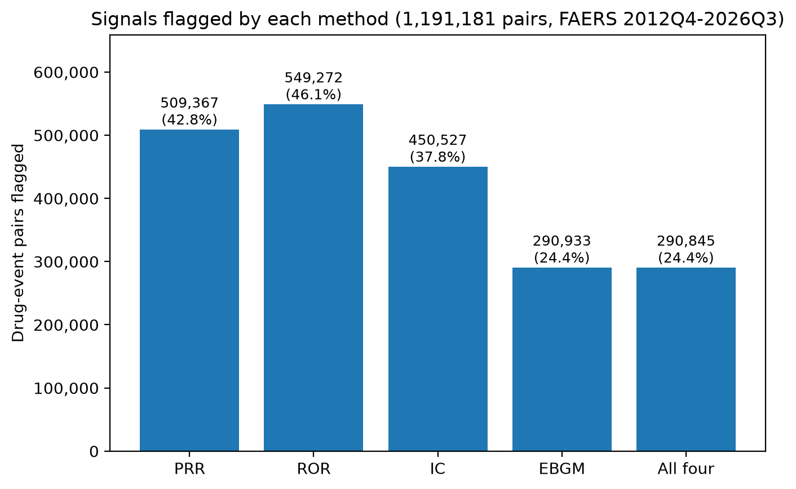
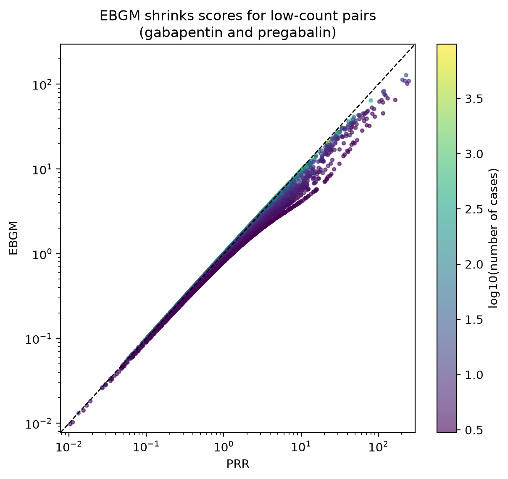
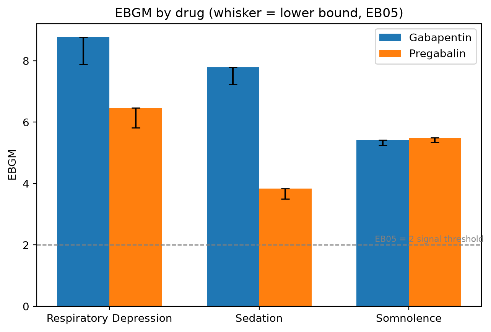

# Signal Detection Methods: PRR, ROR, IC and EBGM on FAERS

A comparison of four disproportionality methods for pharmacovigilance signal detection, run on 14 years of FDA Adverse Event Reporting System (FAERS) data. The worked example is gabapentin and pregabalin.

## Summary

- **Data:** 56 FAERS quarterly ASCII extracts, 2012 Q4 to 2026 Q3 (20.96 million reports).
- **After cleaning:** 17.99 million unique cases (latest version of each case, FDA-deleted cases removed).
- **Analysis set:** 17,730,954 cases (primary suspect drugs only, cases with 30 or fewer events), 3,391 drugs, 1,191,181 drug-event pairs.
- **Methods:** PRR, ROR, IC (BCPNN-style), EBGM.
- **Main finding:** the methods agree on strong signals. With their original rules they flag between 24.4% (EBGM) and 46.1% (ROR) of pairs, but most of that gap comes from the cut-off rules. With matched rules the gap shrinks (41% to 46%, IC 38%). The methods differ most in which pairs they rank first.

## Results

Pairs flagged as a signal by each method:

| Method | Signal rule | Pairs flagged | Share of pairs |
|---|---|---|---|
| PRR | PRR ≥ 2, n ≥ 3, chi-square ≥ 4 | 509,367 | 42.8% |
| ROR | lower 95% CI > 1, n ≥ 3 | 549,272 | 46.1% |
| IC | IC025 > 0 | 450,527 | 37.8% |
| EBGM | EB05 ≥ 2 | 290,933 | 24.4% |
| All four | all rules met | 290,845 | 24.4% |

Almost every EBGM signal is also flagged by the other three methods.



Selected terms for gabapentin and pregabalin:

| Drug | Event | Cases | PRR | ROR | IC025 | EBGM | EB05 |
|---|---|---|---|---|---|---|---|
| Gabapentin | Respiratory depression | 243 | 9.10 | 9.14 | 2.92 | 8.77 | 7.88 |
| Pregabalin | Respiratory depression | 256 | 6.69 | 6.71 | 2.48 | 6.46 | 5.82 |
| Gabapentin | Sedation | 478 | 8.00 | 8.07 | 2.81 | 7.79 | 7.22 |
| Pregabalin | Sedation | 337 | 3.90 | 3.92 | 1.76 | 3.83 | 3.50 |
| Gabapentin | Somnolence | 2,565 | 5.50 | 5.72 | 2.37 | 5.42 | 5.24 |
| Pregabalin | Somnolence | 3,724 | 5.60 | 5.84 | 2.40 | 5.49 | 5.34 |

For high-count pairs the four methods give nearly the same score. They diverge for low-count pairs, where EBGM shrinks the score toward 1.




Full tables: `outputs/gabapentin_pregabalin_all_methods.csv`.

## Further analyses: how much do the methods agree?

Three further analyses use the same 1,191,181 pairs. Each has its own script, an independent checker and a runner that repeats the analysis twice and confirms the output files are identical.

### 1. Agreement with the original rules

- 639,182 pairs (53.7%) are flagged by no method and 290,845 (24.4%) by all four. Only 13,844 (1.2%) are flagged by exactly one method.
- Every EBGM signal is also an IC signal. PRR misses 86 and ROR misses 88 of the 290,933 EBGM signals.
- Agreement between pairs of methods (Jaccard): PRR and ROR 0.92, ROR and IC 0.82, PRR and IC 0.78, IC and EBGM 0.65, PRR and EBGM 0.57, ROR and EBGM 0.53.
- The gap between EBGM and the others is largest for pairs with few cases. EBGM flags 12.0% of pairs with 3 to 4 cases and 51.2% of pairs with 100 or more cases. PRR flags 38.2% and 54.9% in the same groups.
- Rank correlation (Spearman) between the scores is 0.995 or higher for PRR, ROR, IC and EBGM. This is expected across more than a million pairs and says little about the top of the lists.

Files: `outputs/agreement_*.csv`.

### 2. Matched thresholds and top lists

The original rules are not equally strict: PRR uses a point estimate, while ROR, IC and EBGM use lower limits. So the methods were compared again under two matched rules.

| Rule | PRR | ROR | IC | EBGM |
|---|---|---|---|---|
| Point estimate ≥ 2 | 46.0% | 46.1% | not used (log scale) | 41.1% |
| Lower limit above no association (PRR and ROR lower limit > 1, IC025 > 0, EB05 > 1) | 46.1% | 46.1% | 37.8% | 42.1% |

- With matched rules EBGM flags about 41% to 42% of pairs, not 24.4%. Most of the earlier gap came from the EB05 ≥ 2 rule.
- Agreement (Jaccard) under matched rules: PRR and ROR 0.998 to 0.9996, PRR or ROR with EBGM 0.89 to 0.91, IC with EBGM 0.90. Every IC signal is also an EBGM signal under these rules.
- The methods agree much less on which pairs are ranked highest. Shared pairs in the top 100, 1,000 and 10,000 pairs by score:

| Pair of scores | Top 100 | Top 1,000 | Top 10,000 |
|---|---|---|---|
| PRR and ROR | 88 | 965 | 9,851 |
| PRR and EBGM | 20 | 421 | 8,163 |
| PRR and IC | 4 | 123 | 2,605 |
| IC and EBGM | 18 | 278 | 3,473 |

- PRR and ROR top lists are dominated by pairs with few cases (median 12 cases in the top 100 for PRR, 7 in the top 10,000). IC top lists favour pairs with many cases (median 591.5 in the top 100). EBGM is in between (median 107.5 in the top 100).

Files: `outputs/matched_*.csv`, `outputs/topk_overlap.csv`, `outputs/topk_cases.csv`.

### 3. Ties, missing scores and pairs with at least 10 cases

- No score is infinite and no tie crosses the cut-off of any top list, so the top lists do not depend on the tie-break rule (more cases first, then drug name, then event name).
- 86 pairs have no PRR score and 88 have no ROR score. They are ranked last.
- 470,157 pairs have at least 10 cases. Using only those pairs, the top 10,000 lists share 9,563 pairs for PRR and EBGM (95.6%) and 9,775 for PRR and ROR (97.8%). IC stays different: it shares 5,722 pairs (57.2%) with PRR.

| Pair of scores (10 or more cases) | Top 100 | Top 1,000 | Top 10,000 |
|---|---|---|---|
| PRR and ROR | 89 | 956 | 9,775 |
| PRR and EBGM | 37 | 783 | 9,563 |
| PRR and IC | 10 | 239 | 5,722 |
| IC and EBGM | 18 | 284 | 5,792 |

Files: `outputs/ties_check.csv`, `outputs/topk_min10_overlap.csv`, `outputs/topk_min10_cases.csv`.

These analyses measure agreement between methods, not accuracy. There is no reference set of true drug-event relationships here.

## Methods

**Data cleaning**
- Kept the latest version of each case (by case ID, then case version and FDA date).
- Removed cases listed in the FDA's quarterly deleted-case files (51,351 cases).
- Standardised drug names (active ingredient where given, otherwise the reported drug name, upper-cased) and reaction terms (MedDRA preferred terms, upper-cased).

**Filters for the main analysis**
- Primary suspect (PS) drugs only.
- Cases with more than 30 reported events excluded.
- Drugs with fewer than 100 cases and pairs with fewer than 3 cases excluded.

**Why these filters.** A first run counted all suspect drugs and had no limit on events per case. It produced implausible top signals (for example appendicolith and C-reactive protein for gabapentin and pregabalin). Cases behind those pairs had on average 54 to 75 drugs and 38 to 78 events, against 1.5 drugs and 2.9 events for the average case. After filtering, the top signals were clinically plausible (for example myoclonus and asterixis for gabapentin, withdrawal and substance use disorder terms for pregabalin). The unfiltered results are kept in `outputs/signals_unfiltered_all_suspects.csv` for comparison. Respiratory depression scores fell after filtering (gabapentin PRR from 11.27 to 9.10) but stayed clear signals.

**Disproportionality methods** (for each drug-event pair, from the 2x2 table of a, b, c, d)
- **PRR** with chi-square.
- **ROR** with a 95% confidence interval.
- **IC** as log2((a + 0.5) / (expected + 0.5)), with an approximate lower bound (IC025).
- **EBGM**: a two-component gamma mixture prior fitted by maximum likelihood on a random sample of 300,000 pairs (conditioned on at least 3 cases per pair), then posterior EBGM and EB05 for every pair.

**Agreement measures.** Pairs flagged by each method were compared with the overlap, the Jaccard index and Cohen's kappa. Scores were compared with Spearman rank correlation. Top lists of 100, 1,000 and 10,000 pairs were compared by the number of shared pairs.

## Limitations

- FAERS is a spontaneous reporting system. Scores show reporting disproportion, not incidence or risk, and do not show that one drug is more dangerous than another.
- Reporting is affected by media attention, litigation and report type. Duplicate reports remain possible despite case versioning.
- Confounding by indication is present (for example "drug ineffective for unapproved indication" and "diabetic neuropathy" appear as signals).
- Some high-ranking terms rest on small counts (about 10 to 30 cases) and likely reflect small clusters of reports. EBGM shrinks these only moderately here.
- Drug names are not mapped to a standard vocabulary, so spelling variants of the same drug are counted separately.
- The EBGM code is my own implementation, not validated against the FDA's reference software. Treat its numbers as a comparison tool.
- The 30-events-per-case cutoff is a judgement call. Changing it changes the results.
- The agreement analyses use one minimum of 10 cases for the top-list check. Other minimums were not tested. IC was ranked by its point estimate, not by its lower bound.
- Agreement between methods is not accuracy: there is no reference set of true drug-event relationships.

## Reproducing

The data is not in this repository. Download the ASCII files for each quarter from the FDA's FAERS Quarterly Data Files page and unzip them into `data/raw/`. Copy each quarter's `DELETE*.txt` file (from its `Deleted` folder) into `data/deleted_lists/`, then run:

```
pip install -r requirements.txt
python src/build_dataset.py   # slim per-quarter parquet files
python src/combine.py         # one file per table
python src/clean.py           # deduplicate, remove deleted cases
python src/counts.py          # 2x2 counts per drug-event pair
python src/signals.py         # PRR, ROR, IC
python src/ebgm.py            # EBGM and four-method comparison
python src/figures.py         # figures
```

Then the agreement analyses. Each runner repeats the analysis twice, confirms the output files are identical, and runs an independent recount:

```
python src/run_agreement.py   # agreement with the original rules
python src/run_matched.py     # matched thresholds and top lists
python src/run_robust.py      # ties, missing scores, pairs with 10+ cases
```

`src/load_data.py` is an early exploration script and `src/diagnose.py` is the check that found the multi-drug report problem.

## Data source

FDA Adverse Event Reporting System (FAERS) Quarterly Data Extract Files, public data from the U.S. Food and Drug Administration. This project is for learning and portfolio purposes and is not medical advice.

## License

MIT